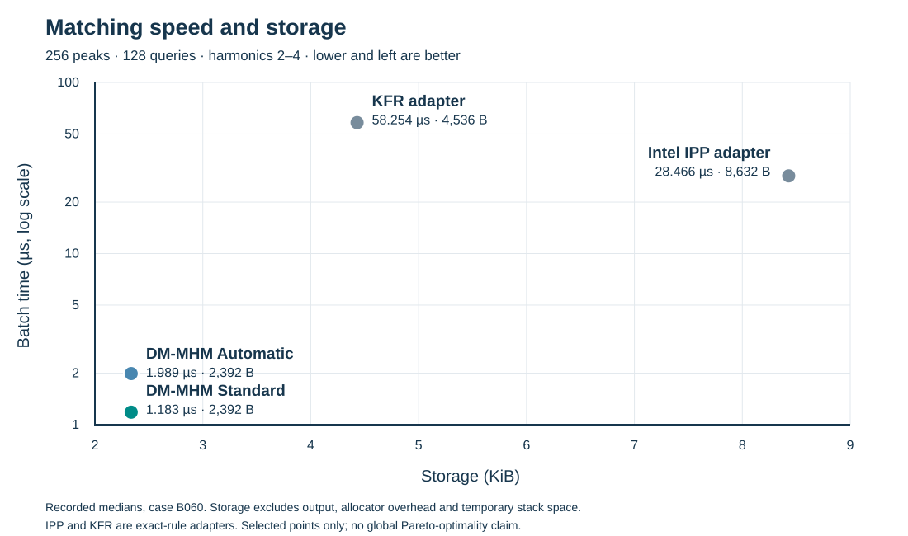

# DM-MHM verification

1. **Origin.** DM-MHM emerged through FPGA experimentation on the processing cost of harmonic assignment in a signal-processing pipeline.
2. **Research.** Further investigation connected the observed gains to established principles of efficient repeated matching, deterministic numerical decisions and independent verification; the contribution is the evaluated combination, not a claim that those principles are new.
3. **Evidence and next steps.** Recorded software comparisons show lower latency on the selected workloads below. The verification suite checks the declared matching results and state continuity; further independent testing is required to establish performance and usefulness across additional systems and applications.

**Technical description:** DM-MHM is a deterministic 64-bit harmonic-assignment engine that returns eligible frequency matches through a versioned C interface.

**In plain language:** It reduces the time spent connecting detected frequencies to a signal's harmonics, leaving more processing capacity for the rest of the application.

This repository contains a binary verification runner, fixed input/output fixtures,
the public C interface header and selected benchmark records. It contains no
matching implementation, executable reference model, detailed algorithm specification,
vendor-adapter source or private engine binary. No HTTP service is included.

## Recorded software comparisons

Software times precede DM-MHM times in each row. These are separate historical experiments, with the original timing boundaries retained; the rows are not pooled.

| Comparison | Measured boundary | Recorded result |
| --- | --- | --- |
| Intel IPP adapter | Matching batch: 275.761 → 11.040 µs | 25.0× faster |
| KFR adapter | Matching batch: 593.153 → 11.040 µs | 53.7× faster |
| LibXtract | Shared-task host call: 81.55 → 54.90 µs | 32.7% less time |
| Essentia | Real-audio pipeline: 3,789 → 3,602 µs | 4.9% less time |
| sms-tools | Real-audio pipeline: 22,813 → 21,282 µs | 6.7% less time |
| librosa | Clip pipeline: 993–1,384 vs. 823–1,164 µs | Lower recorded latency |
| TorchAudio | Clip pipeline: 1,020–1,419 vs. 823–1,164 µs | Lower recorded latency |

The first two rows use 256 peaks, 128 ascending queries and harmonic orders 1–32 on the selected 30–60 Hz workload. The clip ranges span three noise levels and compare the same processing workload, not pitch-estimation accuracy. LibXtract is a shared-task comparison; Essentia and sms-tools are assignment substitutions preserving the declared tested outputs. These are not claims of general superiority over the named libraries.

Sources: *Matching Through 32 Harmonics*, pp. 2–3; *DM-MHM DSP Benchmark Overview* (12 November 2026); *DM-MHM Consolidated Benchmark Report* (11 November 2026). The selected matching measurements and their PDF identifier are retained in [the benchmark record](benchmarks/selected_results.json).

## Matching time and storage

The following separate experiment uses **256 peaks, 128 ascending queries and harmonics 2–4**. Times are microseconds per complete batch. Load includes validation, storage and required conversion; match includes validation, target creation/conversion, selection and returned results. “Both” is a measured load followed by matching, not the sum of independently reported medians. No audio frontend is timed.

| Implementation | Load (µs) | Match (µs) | Both (µs) | Storage (bytes) |
| --- | ---: | ---: | ---: | ---: |
| DM-MHM Automatic | 0.130 | 1.989 | 2.104 | 2,392 |
| DM-MHM Standard | 0.130 | 1.183 | 1.298 | 2,392 |
| Intel IPP 2026.1.0 adapter | 0.155 | 28.466 | 28.686 | 8,632 |
| KFR 7.2.0 adapter | 0.116 | 58.254 | 58.434 | 4,536 |



**Pareto context:** Standard takes less matching time and less persistent storage than the two selected vendor adapters on this case. Pareto analysis considers these objectives together; this selected table does not establish a global frontier or include every competing method. Storage includes the tested persistent objects and allocated buffers, but excludes common returned output, allocator overhead and temporary stack space.

Source: *Compact-Batch 64-bit Comparison Tables*, pp. 1–2, case B060 (12 November 2026). IPP and KFR rows are explicitly identified adapters implementing the same matching contract, not native vendor harmonic-matcher APIs. Historical timing is not a measurement of the newly hardened interface wrappers or a protected engine build.

The runner compares a separately supplied binary with **343 saved operation results**. Expected results are fixed data; no general-purpose matching rule is evaluated by the runner. Passing these fixtures does not establish correctness for every possible input, universal pointer safety or the historical performance figures. The saved inputs and outputs necessarily disclose some observable behavior, but neither private implementation is included.

## Run the independent checks

Requires Python 3.10+ with its standard library. Verify the fixture file before supplying an authorized engine:

```sh
python3 -m unittest discover -s tests -v
python3 -m harness.grade
```

Without an engine, the last command reports `READY_ENGINE_NOT_TESTED` and
`ENGINE_NOT_SUPPLIED`. Fixture integrity is not an engine conformance pass.

To test a separately obtained native library with the five-function interface:

```sh
python3 -m harness.grade --engine /path/to/authorized-library.so --output results/verification.json
```

On Windows, supply the authorized DLL path. Native execution runs in a child process
with a timeout; only use libraries from a trusted source. The runner owns its
buffers and caps fixture sizes before native calls. The raw C ABI still requires
valid buffers and live contexts. No arbitrary-pointer safety guarantee is made.
Results are saved-output agreement, not audio detection accuracy, rotor identity
or physical hardware qualification.

CMake 3.22+ and C11/C++20 compilers optionally provide header-only compile checks:

```sh
cmake -S . -B build
cmake --build build
ctest --test-dir build --output-on-failure
```

These build checks contain no linked matching implementation.

## Optional comparisons

[Selected historical measurements](benchmarks/README.md) have a different boundary
from this runner and are not measurements of a protected build. No vendor-adapter
source or runtime is distributed. An authorized adapter binary may be checked
separately through the same C interface.

<!-- PLACEHOLDER: owner-selected charts and discussion. -->

## License

The original verification material is Apache-2.0. See LICENSE and NOTICE.
This grants no license to separate engine implementations or third-party products.
Fetching or installing a dependency does not remove its license requirements.

<!-- PLACEHOLDER: evaluation distribution terms and contact details. -->
